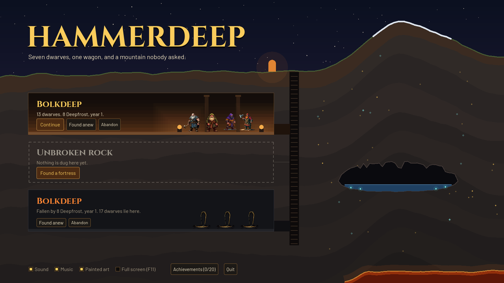
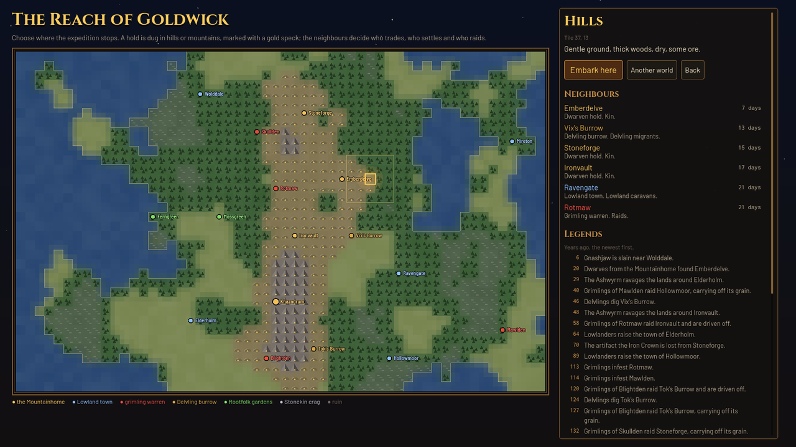
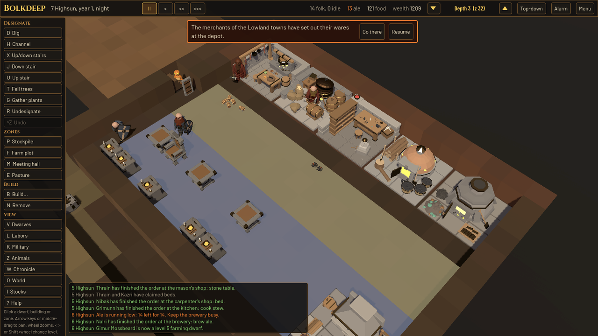
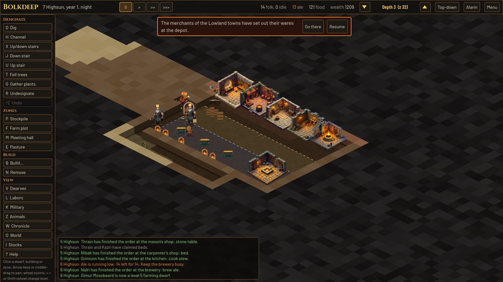
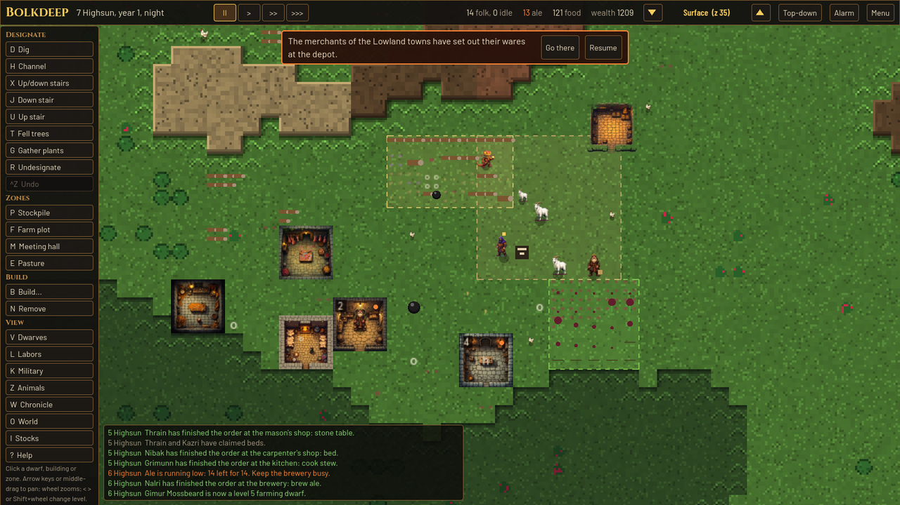
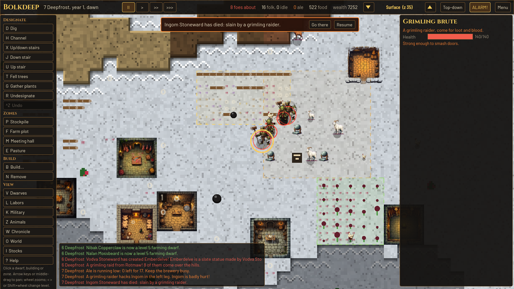

# Hammerdeep

A dwarven fortress-management game in Godot 4.7 (.NET / C#), in the genre of the classic colony
sims, with its own names, lore and look. Seven dwarves strike the earth on a mountainside of a
generated world; you designate digging, zones, buildings and work orders, and the dwarves choose
their own tasks by skill, labour and need. Raids, great beasts out of the world's legends, weather,
nobles with demands, strangers at the gate, caverns below caverns -- and an ancient vault at the
bottom of it all.

## Screenshots

| | |
|---|---|
|  |  |
| The world map: sites, history and neighbours, all from one seed | The great hall in the 3D view |
|  |  |
| The same hall in the isometric view | The surface, top-down, with the painted art |

## What is in it

- **A generated world** with history and neighbours; an embark of 192 x 192 x 50 cells with soil and
  rock layers, ore, gems, three cavern layers, magma, ponds and woods.
- **Indirect control:** designations, stockpiles, farms, buildings, work orders and labours; dwarves
  pick their own work, and eat, drink, sleep, pray, feast, chat and feud.
- **Crafting chains:** wood, stone, metal (smelting, alloys, a magma forge), food and ale, leather,
  runes; strange moods and named artifacts.
- **Threats:** grimling raids, cave creatures and five great beasts of the legends; squads, traps,
  doors and drawbridges.
- **The world knocks:** caravans, migrants of four peoples, a noble with demands, bards, refugees,
  envoys and wanderers, weather that floods, burns and freezes.
- **Three views:** top-down, isometric and 3D (F2), with modelled buildings, rigged figures and items.
- **Ironman saves** in three slots, synthesised music and sound, a tutorial, achievements.

## Running it

Needs **Godot 4.7 (.NET edition)** and the **.NET SDK**. Open the folder in Godot and press Play, or
use the scripts (written for Windows Godot driven from WSL; set paths in `.env`, see `.env.example`):

    ./play.sh                   play
    ./play.sh --build           compile only
    ./play.sh --check           the headless self-check (about 600 checks)
    ./play.sh --shots           a walkthrough that writes screenshots to shots/
    bash scripts/export.sh      a Windows build, checked against the exported executable

**Controls, in brief:** arrows or middle-drag pan, the wheel zooms, `<` `>` change level; F2 cycles
the views (in 3D, `[` `]` or a right-drag turn the camera); D dig, H channel, J/U/X stairs, T fell,
G gather, P stockpile, F farm, B build; Space pauses, 1 2 3 set the speed; `?` opens the help.

## The project

- `docs/DESIGN.md` -- the design, milestones and every rule with its numbers.
- `src/Sim` -- the rules as plain data; `src/View` the views; `src/UI` the screens; `tests/` the self-check.
- `assets/` -- fonts (Cinzel, Barlow, Inconsolata; SIL Open Font License, licences beside them),
  painted sprites and 3D models generated for this project.
